# Aegis-360-AI — Architecture & Agentic Workflow Report

**Generated:** 2026-07-20  
**Version:** 1.1.0 (released 2026-06-13)  
**Classification:** Technical & Executive Reference  

---

## Table of Contents

1. [Agent Overview](#1-agent-overview)
2. [Workflow Scope](#2-workflow-scope)
3. [Agentic AI Workflow](#3-agentic-ai-workflow)

---

## 1. Agent Overview

**Aegis-360-AI** is an autonomous, AI-augmented penetration testing platform designed to integrate 200+ security tools with multiple large language models (Claude Sonnet, DeepSeek V4 Pro, Groq Llama/Qwen) via a Flask REST API (300+ endpoints) and a Model Context Protocol (MCP) bridge (281+ tools) for Claude Desktop. It is built on Python 3.11+ and runs natively on Kali Linux 2024.1+, Ubuntu 22.04+, and macOS 13+.

**Primary cybersecurity problems solved:**
- Eliminates manual tool-chaining across 200+ security utilities
- Enforces structured, phase-gated penetration testing methodology
- Automates vulnerability discovery, triage, CVSS scoring, and remediation advice generation
- Enables LLM-driven adversarial testing of AI/LLM products

**Target users:** Professional red teams, bug bounty hunters, CTF competitors, and penetration testing consultancies.

**Core objectives:**
- Deliver end-to-end autonomous penetration testing with human-override capability
- Enforce phase discipline through a multi-model orchestration engine that routes tasks to the optimal AI model per phase
- Produce audit-ready reports with full handoff logs, CVSS scoring, and remediation guidance

**Key AI capabilities:**
- Multi-model orchestration (DeepSeek V4 Pro for recon/analysis; Claude Sonnet for exploitation/reporting)
- 817 AI skill definitions mapped to MITRE ATT&CK
- LLM adversarial testing via Augustus (210+ probes across 28 LLM providers)
- AI-assisted payload generation, attack chain planning, and executive report writing

**Supported security assessment domains:** Web application, API (REST/GraphQL/SOAP), network/infrastructure, Active Directory/Windows, cloud (AWS/GCP/Azure), containers (Docker/Kubernetes), mobile (Android/iOS), binary analysis/reverse engineering, OSINT/threat intelligence, wireless, and LLM/AI system security.

**How it differs from traditional tools:** Traditional tools operate in isolation; Aegis-360-AI chains them into a structured, phase-enforced agentic workflow with LLM-driven decision-making at each stage, cross-phase state persistence, and automated professional-grade reporting — all accessible through a single Claude Desktop interface.

**Major integrations (Implemented):** Burp Suite (REST API + proxy), Anthropic Claude API, OpenRouter (DeepSeek V4 Pro), Groq (Llama/Qwen), Shodan, Censys, VirusTotal, HaveIBeenPwned, Praetorian open-source toolset (14 tools), and SurfaceZero pre-authentication scanner.

---

## 2. Workflow Scope

**Total major workflow phases:** 8  
**Total MCP tools:** 281+  
**Total Flask API endpoints:** 175+  
**Total integrated security tools:** 200+  
**Total AI skill definitions:** 817  

| Workflow Component | Purpose | Automated | Human Approval Required |
|---|---|---|---|
| **Project Initialization** | Create workflow state, assign workflow ID, configure target scope, select AI models per phase | Yes | No |
| **Scope Ingestion** | Accept target URL/IP/CIDR/domain, define exclusions, set engagement parameters | Yes | Yes (scope confirmation) |
| **Asset Discovery / Reconnaissance** | Subdomain enumeration (subfinder, amass, fierce), DNS resolution, ASN/IP range mapping, Shodan/Censys OSINT, certificate transparency, historical URLs (gau, waybackurls) | Yes | No |
| **Service Enumeration** | Port scanning (nmap, masscan, rustscan), service fingerprinting (fingerprintx, nerva), technology stack detection, web crawling (katana, hakrawler), directory/parameter discovery (ffuf, gobuster, arjun, paramspider) | Yes | No |
| **Pre-Authentication Surface Scan** | SurfaceZero v2.1 — JS analysis, 45-pattern secret scanning, GraphQL introspection, CORS/cookie/PII analysis, 123-path config discovery, 114-probe API harvesting | Yes | No |
| **Vulnerability Analysis** | Nuclei/Nikto/WPScan scanning, CVSS scoring, exploitability assessment, false-positive triage, AI-driven severity prioritization via DeepSeek V4 Pro | Yes | No |
| **Validation Gate** | Orchestrator gate check — confirms RECON, ENUMERATION, and VULNERABILITY_ANALYSIS phases are fully complete before permitting exploitation | Yes (gate logic) | No (automated gate) |
| **API Security Testing** | REST/GraphQL/SOAP endpoint fuzzing, JWT analysis, IDOR testing, mass assignment, rate limiting bypass, broken auth (arjun, hadrian, api-schema-analyzer) | Yes | No |
| **Authentication & Credential Testing** | Brute force / credential spray (Hydra, Medusa, Patator, Trident), hash cracking (Hashcat, John), NTLM recon (NTLMRecon), Windows auth attacks (NetExec, evil-winrm) | Yes | Yes (active attack approval recommended) |
| **LLM-Based Exploitation Planning** | Claude Sonnet generates targeted exploitation plans, payload sets, and bypass techniques based on accumulated findings — gated to EXPLOITATION phase only | Yes | No |
| **Exploit Execution** | Payload generation (msfvenom, pwntools, custom scripts), SQL injection (sqlmap), XSS (dalfox, XSStrike), SSRF, SSTI, deserialization, directory traversal (dotdotpwn), XXE, RCE chains | Yes | Yes (destructive actions) |
| **Active Directory / Windows Assessment** | BloodHound enumeration, Kerberoasting (impacket), Pass-the-Ticket, DCSync, ADCS ESC1/ESC8, shadow credentials, NTLM relay, constrained delegation abuse | Yes | Yes (domain attacks) |
| **Cloud & Container Assessment** | AWS (Pacu, Scout Suite, Prowler), GCP (Forseti, gcpbucketbrute), Azure (AADInternals, ROADtools), Kubernetes (kube-hunter, kube-bench), Docker (trivy, docker-bench-security) | Yes | No |
| **Binary Analysis** | Static (Ghidra, radare2, binwalk, checksec, strings), dynamic (GDB/PEDA, rr-debugger, Frida), symbolic execution (angr), fuzzing (AFL++), ROP chain generation (ROPgadget, ropper) | Yes | No |
| **LLM Adversarial Testing** | Augustus module — 210+ probes across 28 LLM providers, jailbreak testing, system prompt leakage, prompt injection, multi-turn attacks | Yes | No |
| **Context Enrichment** | CVE feed lookup, exploit-db cross-reference, VirusTotal reputation, HaveIBeenPwned checks, Shodan banner correlation | Yes | No |
| **Risk Prioritization** | CVSS v3.1 base/temporal scoring, EPSS integration, business impact correlation, KEV catalog check, SSVC framework triage | Yes | No |
| **Evidence Collection** | Screenshot capture, Burp Suite history export, output file archiving, workflow state JSON persistence, structured finding storage | Yes | No |
| **Burp Suite Integration** | Proxy history retrieval, active scanner launch, issue extraction, repeater/intruder augmentation via REST API | Yes | No |
| **Report Generation** | AI-generated Markdown pentest report covering executive summary, technical findings, CVSS scores, PoC evidence, and remediation guidance (Claude Sonnet) | Yes | No |
| **Executive Summary Creation** | Plain-language risk narrative, business impact analysis, compliance gap flags, prioritized finding list | Yes | No |
| **Remediation Guidance** | Per-finding specific remediation steps, code-level fix recommendations, configuration hardening guidance | Yes | No |
| **Ticket Creation** | Planned — integration with issue-tracking systems not yet implemented | Planned | Planned |
| **Knowledge-Base Update** | 817 skill definitions maintained; workflow state stored to `workflow_states/` JSON; pentest outputs to `pentest_reports/` | Yes (file I/O) | No |
| **Human Review / Override** | Analyst can interrupt any phase, review accumulated findings, override phase assignments, and inject manual findings | Yes (API) | Optional |
| **Final Report Export** | Markdown report saved to `pentest_reports/<engagement>/`; PDF/DOCX export planned | Partially | No |
| **CI/CD / DevSecOps Integration** | checkov/terrascan IaC scanning, Falco runtime monitoring, Trivy container image scanning, Grype SBOM scanning, gokart Go SAST | Yes | No |
| **Notification / Alerting** | Planned — Slack/email/webhook notifications not yet implemented | Planned | Planned |
| **Orchestration Engine** | `aegis_360_orchestrator.py` — phase sequencing, model routing, PhaseViolationError/PhaseGateError guards, state persistence, handoff logging | Yes | No |

---

## 3. Agentic AI Workflow

### 3.1 Numbered Sequential Workflow

---

#### Stage 1 — Project Initialization

- **Objective:** Create a persistent workflow session and configure engagement parameters
- **Input:** Target (URL / IP / domain / CIDR), engagement type (web app / network / cloud / AD), optional scope exclusions
- **Processing:** Orchestrator generates a unique `workflow_id`, instantiates a `WorkflowState` object, sets all phases to `pending`, persists initial state to `workflow_states/<workflow_id>.json`
- **AI reasoning:** None at this stage; purely deterministic setup
- **Output:** Workflow ID, persisted JSON state file, phase queue
- **Tools/APIs invoked:** `aegis_360_orchestrator.py` (`WorkflowState.__init__`), filesystem write to `workflow_states/`
- **Next stage:** Stage 2 — Scope Ingestion

---

#### Stage 2 — Scope Ingestion

- **Objective:** Ingest and validate the engagement scope to constrain all downstream activity
- **Input:** Target specification from analyst (URL, IP range, domain list, exclusions)
- **Processing:** Scope parameters stored in workflow state; target URL validated; engagement type flag set; phase transitioned to `in_progress`
- **AI reasoning:** None; deterministic scope parsing
- **Output:** Validated scope object embedded in workflow state
- **Tools/APIs invoked:** Orchestrator state update
- **Next stage:** Stage 3 — Asset Discovery & Reconnaissance

---

#### Stage 3 — Asset Discovery & Reconnaissance

- **Objective:** Map the full external attack surface — subdomains, IPs, ASNs, certificates, historical URLs, OSINT
- **Input:** Target domain / IP from workflow state
- **Processing performed:**
  - Subdomain enumeration via subfinder, amass, fierce, dnsenum
  - DNS resolution and MX/NS/TXT record analysis
  - ASN and IP range lookup
  - Certificate transparency log mining (TLS cert enumeration)
  - Historical URL collection via gau, waybackurls
  - OSINT via TheHarvester, Shodan, Censys, Spiderfoot
  - Technology fingerprinting via httpx, whatweb, wappalyzer
  - SurfaceZero pre-authentication scan (JavaScript analysis, secrets detection, GraphQL introspection, CORS analysis, PII detection, API harvesting)
- **AI reasoning:** **DeepSeek V4 Pro** analyzes raw recon output, identifies high-value targets, selects follow-on tools, prioritizes subdomain attack surface
- **Output:** Subdomain list, IP/port map, technology stack profile, OSINT summary, SurfaceZero pre-auth report, accumulated findings stored in workflow state
- **Tools/APIs invoked:** subfinder, amass, fierce, dnsenum, theharvester, httpx, gau, waybackurls, shodan-cli, censys-cli, spiderfoot, recon-ng, surfacezero (8 scanning modules), DeepSeek V4 Pro via OpenRouter
- **Next stage:** Stage 4 — Service Enumeration

---

#### Stage 4 — Service Enumeration

- **Objective:** Enumerate open ports, running services, web content, and input parameters across all discovered assets
- **Input:** IP/subdomain list from Stage 3 workflow state
- **Processing performed:**
  - Port scanning: nmap (full/stealth/version), masscan, rustscan
  - Service fingerprinting: fingerprintx (170+ protocols), nerva
  - Web directory/file brute-force: gobuster, ffuf, feroxbuster, dirb, dirsearch
  - Web crawling: katana, hakrawler
  - Parameter discovery: arjun (GET/POST/JSON/XML), paramspider (archive mining), x8
  - GraphQL endpoint detection: graphw00f
  - API schema extraction: api-schema-analyzer
  - SMB/NetBIOS enumeration: enum4linux, enum4linux-ng, smbmap, rpcclient, nbtscan
  - SNMP enumeration
- **AI reasoning:** **DeepSeek V4 Pro** correlates service banners with CVE databases, identifies unexpected ports/services, prioritizes attack vectors based on technology stack
- **Output:** Service inventory, web content map, parameter list, API endpoint inventory, SMB share list; all appended to workflow state findings
- **Tools/APIs invoked:** nmap, masscan, rustscan, fingerprintx, gobuster, ffuf, feroxbuster, katana, hakrawler, arjun, paramspider, graphw00f, enum4linux, smbmap, DeepSeek V4 Pro via OpenRouter
- **Next stage:** Stage 5 — Vulnerability Analysis

---

#### Stage 5 — Vulnerability Analysis

- **Objective:** Identify, triage, score, and prioritize all vulnerabilities discovered across the attack surface
- **Input:** Service inventory, technology stack, parameter list, API endpoints from Stages 3–4
- **Processing performed:**
  - Automated vulnerability scanning: nuclei (community + custom templates), nikto, wpscan (if WordPress detected)
  - Container/IaC scanning: trivy, checkov, terrascan, grype
  - Cloud misconfiguration scanning: prowler (AWS), scout-suite, cloudmapper
  - Active Directory vulnerability assessment: BloodHound CE, impacket, NTLMRecon
  - LLM adversarial testing (if LLM endpoints detected): Augustus with 210+ probes
  - CVSS v3.1 base score calculation
  - EPSS (Exploit Prediction Scoring System) lookup
  - KEV (Known Exploited Vulnerabilities) catalog cross-reference
  - Exploit-DB and CVE database lookup
  - Business impact correlation
  - False-positive filtering via AI review
- **AI reasoning:** **DeepSeek V4 Pro** performs AI-driven severity triage — reviews raw scanner output, eliminates informational false positives, assigns exploitability assessment, and produces a prioritized vulnerability list with justifications
- **Output:** Prioritized vulnerability list with CVSS scores, EPSS scores, KEV flags, and business impact annotations; exploitation readiness flag set in workflow state
- **Tools/APIs invoked:** nuclei, nikto, wpscan, trivy, checkov, terrascan, prowler, scout-suite, bloodhound, augustus, exploit-db, CVE APIs, DeepSeek V4 Pro via OpenRouter
- **Next stage:** Stage 6 — Validation Gate

---

#### Stage 6 — Validation Gate

- **Objective:** Enforce phase discipline — confirm all pre-exploitation stages are complete before permitting Claude API exploitation calls
- **Input:** Workflow state with phase completion flags for RECON, ENUMERATION, VULNERABILITY_ANALYSIS
- **Processing performed:**
  - Checks `phase_status['recon'] == 'completed'`
  - Checks `phase_status['enumeration'] == 'completed'`
  - Checks `phase_status['vulnerability_analysis'] == 'completed'`
  - Verifies `exploitation_readiness_flag == True` (set by Stage 5)
  - Raises `PhaseGateError` if any check fails
  - Raises `PhaseViolationError` if Claude API was invoked in any forbidden pre-exploitation phase
  - Logs gate passage decision with timestamp to handoff log
- **AI reasoning:** No AI — pure deterministic gate logic in orchestrator
- **Output:** Gate PASSED or FAILED; EXPLOITATION phase unlocked in workflow state on pass
- **Tools/APIs invoked:** `aegis_360_orchestrator.py` gate check methods (`_check_phase_gate`, `PhaseGateError`, `PhaseViolationError`)
- **Next stage:** Stage 7 — Exploitation (if gate passes)

---

#### Stage 7 — Exploitation

- **Objective:** Develop and execute targeted exploits against validated vulnerabilities to confirm impact and demonstrate risk
- **Input:** Prioritized vulnerability list from Stage 5; validation gate confirmed; target details from workflow state
- **Processing performed:**
  - Exploitation planning and payload strategy by Claude Sonnet
  - SQL injection exploitation: sqlmap (union, blind, time-based, OOB)
  - XSS exploitation: dalfox, XSStrike with intelligent payloads
  - API abuse: IDOR, mass assignment, broken function-level authorization
  - Directory traversal: dotdotpwn
  - SSRF, SSTI, XXE, deserialization exploit chains
  - JWT attacks: algorithm confusion, none algorithm, signature bypass
  - OAuth misconfiguration exploitation
  - GraphQL query/mutation abuse
  - Active Directory attacks: Kerberoasting, Pass-the-Ticket, DCSync, ADCS ESC1/ESC8, NTLM relay, shadow credentials, constrained delegation abuse
  - Binary exploitation: ROP chain generation (ROPgadget, ropper), pwntools scripting, angr symbolic execution
  - Cloud exploitation: Pacu (AWS), gcpbucketbrute (GCP)
  - Credential testing: Hydra, Medusa, Patator, Hashcat, John, Trident (AD-aware password spray)
  - Payload generation: msfvenom, custom shellcode
  - Burp Suite active scanning and issue extraction
- **AI reasoning:** **Claude Sonnet 4.6** generates exploitation plans, selects optimal payloads for each vulnerability class, designs bypass sequences for WAFs/filters, and writes PoC exploit code — accessible only in EXPLOITATION phase by orchestrator design
- **Output:** Confirmed exploits, PoC code, screenshots/evidence, session tokens, extracted data, privilege escalation paths; all stored in workflow state findings with timestamps
- **Tools/APIs invoked:** sqlmap, dalfox, XSStrike, dotdotpwn, impacket suite, netexec, evil-winrm, hydra, medusa, hashcat, john, pacu, bloodhound, msfvenom, pwntools, arjun, hadrian, burp REST API, Claude Sonnet 4.6 (Anthropic API)
- **Next stage:** Stage 8 — Reporting

---

#### Stage 8 — Reporting

- **Objective:** Synthesize all findings, evidence, and context into a professional penetration testing report with executive summary and remediation guidance
- **Input:** Complete workflow state — all phases' findings, CVSS scores, PoC evidence, exploitation results, handoff logs
- **Processing performed:**
  - Claude Sonnet reads all accumulated findings from workflow state
  - Generates structured Markdown report with:
    - Executive Summary (plain-language risk narrative for non-technical stakeholders)
    - Scope and Methodology section
    - Attack Surface summary
    - Detailed technical findings (per vulnerability: title, CVSS score, EPSS, description, evidence/screenshots, reproduction steps, PoC code)
    - Business impact analysis per finding
    - Risk ratings and prioritization matrix
    - Remediation guidance (specific, actionable, per-finding)
    - Compliance gap flags (if applicable)
    - Appendices (tool output, raw evidence)
  - Report saved to `pentest_reports/<engagement_name>/` as Markdown
  - Workflow state updated to phase = `completed`
- **AI reasoning:** **Claude Sonnet 4.6** writes the entire report — correlates technical findings with business impact, selects relevant evidence, crafts precise remediation language, and generates the executive narrative
- **Output:** Professional Markdown pentest report in `pentest_reports/`; workflow state marked `END`
- **Tools/APIs invoked:** Claude Sonnet 4.6 (Anthropic API), filesystem write to `pentest_reports/`, workflow state JSON update
- **Next stage:** Stage 9 — Human Review / Final Export

---

#### Stage 9 — Human Review & Final Export

- **Objective:** Analyst reviews AI-generated report, adds manual findings, approves for delivery
- **Input:** Generated Markdown report from Stage 8
- **Processing performed:**
  - Analyst reviews findings, CVSS scores, PoC evidence
  - Optional: add manual findings via API (`/api/orchestrator/add_finding`)
  - Optional: override severity ratings
  - Optional: adjust remediation language
  - Export as Markdown (implemented); PDF/DOCX export (planned)
- **AI reasoning:** Human-in-the-loop; AI does not re-process in this stage
- **Output:** Approved final report ready for client delivery
- **Tools/APIs invoked:** Flask REST API (`/api/orchestrator/` endpoints), file system read/write
- **Next stage:** End of engagement

---

### 3.2 Mermaid Flowchart

```mermaid
flowchart TD

    A([🚀 Start: Engagement Initiated]) --> B

    B[Stage 1: Project Initialization\nOrchestrator generates workflow_id\nWorkflowState created & persisted\nAll phases set to PENDING]
    B --> C

    C[Stage 2: Scope Ingestion\nTarget URL / IP / Domain / CIDR ingested\nExclusions defined\nEngagement type configured]
    C --> D

    D[Stage 3: Asset Discovery & Reconnaissance\n🤖 Model: DeepSeek V4 Pro\nSubdomain enumeration - subfinder, amass, fierce\nDNS, ASN, certificate transparency\nOSINT - Shodan, Censys, TheHarvester\nHistorical URLs - gau, waybackurls\nSurfaceZero pre-auth surface scan\nTechnology fingerprinting]
    D --> E

    E[Stage 4: Service Enumeration\n🤖 Model: DeepSeek V4 Pro\nPort scanning - nmap, masscan, rustscan\nService fingerprinting - fingerprintx, nerva\nDir/file brute-force - gobuster, ffuf, feroxbuster\nWeb crawling - katana, hakrawler\nParameter discovery - arjun, paramspider\nGraphQL detection - graphw00f\nAPI schema extraction\nSMB/NetBIOS enum - enum4linux, smbmap]
    E --> F

    F[Stage 5: Vulnerability Analysis\n🤖 Model: DeepSeek V4 Pro\nVuln scanning - nuclei, nikto, wpscan\nCloud misconfig - prowler, scout-suite\nAD assessment - BloodHound, NTLMRecon\nLLM testing - Augustus 210+ probes\nCVSS v3.1 scoring\nEPSS + KEV catalog lookup\nFalse-positive triage\nPrioritized vuln list generated]
    F --> G

    G{Stage 6: Validation Gate\nOrchestrator Phase Guard\nRECON complete?\nENUMERATION complete?\nVULN_ANALYSIS complete?\nExploitation readiness flag set?}

    G -- ❌ Gate FAILED\nPhaseGateError raised --> H
    G -- ✅ Gate PASSED\nEXPLOITATION phase unlocked --> I

    H[🔁 Return to Failed Phase\nAnalyst notified\nPhase re-executed]
    H --> G

    I[Stage 7: Exploitation\n🤖 Model: Claude Sonnet 4-6\nExploitation planning + payload strategy\nSQL injection - sqlmap\nXSS - dalfox, XSStrike\nAPI abuse - IDOR, mass assignment\nSSRF, SSTI, XXE, deserialization\nJWT + OAuth attacks\nGraphQL mutation abuse\nAD attacks - Kerberoasting, DCSync\nADCS ESC1/ESC8, NTLM relay\nCloud exploitation - Pacu, gcpbucketbrute\nCredential testing - Hydra, Hashcat, Trident\nBurp Suite active scanning\nEvidence collected + stored]

    I --> J

    J{Human Approval Required?\nDestructive action detected\nDomain-level attack planned\nActive brute-force required}

    J -- ✅ Approved --> K
    J -- ⏸ Awaiting approval --> J

    K[Stage 8: Report Generation\n🤖 Model: Claude Sonnet 4-6\nExecutive Summary - business risk narrative\nTechnical findings - CVSS, EPSS, PoC, evidence\nBusiness impact analysis\nRemediation guidance per finding\nCompliance gap flags\nMarkdown report saved to pentest_reports/\nWorkflow state marked COMPLETED]
    K --> L

    L[Stage 9: Human Review & Final Export\n👤 Analyst reviews AI-generated report\nAdd manual findings via API\nOverride severity ratings\nApprove for client delivery\nFinal Markdown report exported\nPDF/DOCX export — PLANNED]

    L --> M([✅ End: Engagement Complete])

    %% Parallel sub-flows
    D -.->|SurfaceZero pre-auth scan| SZ[SurfaceZero v2.1\nJS analysis\n45-pattern secret scanning\nGraphQL introspection\nCORS + cookie analysis\nPII detection\n123-path config discovery\n114-probe API harvesting]
    SZ -.-> E

    F -.->|LLM system detected| AUG[Augustus Module\n210+ adversarial probes\n28 LLM providers\nPrompt injection\nSystem prompt leakage\nJailbreak testing\nMulti-turn attacks]
    AUG -.-> G

    I -.->|Burp Suite active| BURP[Burp Suite Integration\nProxy history retrieval\nActive scanner launch\nIssue extraction\nRepeater augmentation]
    BURP -.-> K

    %% Styling
    style A fill:#1a1a2e,color:#00ff41,stroke:#00ff41
    style M fill:#1a1a2e,color:#00ff41,stroke:#00ff41
    style G fill:#2d1b00,color:#ffaa00,stroke:#ffaa00
    style H fill:#2d0000,color:#ff4444,stroke:#ff4444
    style J fill:#2d1b00,color:#ffaa00,stroke:#ffaa00
    style D fill:#001a00,color:#00cc33,stroke:#00cc33
    style E fill:#001a00,color:#00cc33,stroke:#00cc33
    style F fill:#001a00,color:#00cc33,stroke:#00cc33
    style I fill:#00001a,color:#4488ff,stroke:#4488ff
    style K fill:#00001a,color:#4488ff,stroke:#4488ff
    style SZ fill:#1a0000,color:#ff8888,stroke:#ff8888
    style AUG fill:#1a0000,color:#ff8888,stroke:#ff8888
    style BURP fill:#001a1a,color:#00cccc,stroke:#00cccc
```

---

## Appendix A — AI Model Routing Summary

| Phase | Model | Provider | Rationale |
|---|---|---|---|
| RECON | DeepSeek V4 Pro | OpenRouter | Cost-efficient, strong reasoning for OSINT correlation and target prioritization |
| ENUMERATION | DeepSeek V4 Pro | OpenRouter | High-volume output processing, service banner correlation |
| VULNERABILITY_ANALYSIS | DeepSeek V4 Pro | OpenRouter | CVE triage, CVSS scoring, exploitability reasoning |
| VALIDATION_GATE | Orchestrator (no LLM) | Local | Deterministic gate — no AI bias permitted |
| EXPLOITATION | Claude Sonnet 4.6 | Anthropic | Best-in-class reasoning for complex multi-step exploit chains and bypass generation |
| REPORTING | Claude Sonnet 4.6 | Anthropic | Superior technical writing and business impact articulation |
| Fallback (chat/CLI) | Groq Llama/Qwen | Groq | Free tier for quick lookups and planning tasks |

---

## Appendix B — Implementation Status Summary

| Feature | Status |
|---|---|
| Multi-model orchestration engine | Implemented |
| Phase-gated workflow with PhaseViolationError guards | Implemented |
| 281+ MCP tools for Claude Desktop | Implemented |
| Flask REST API (175+ endpoints) | Implemented |
| SurfaceZero pre-auth scanner (8 modules) | Implemented |
| Augustus LLM adversarial testing (210+ probes) | Implemented |
| Praetorian toolset integration (14 tools) | Implemented |
| Burp Suite REST API integration | Implemented |
| AI-generated Markdown pentest report | Implemented |
| CVSS v3.1 scoring | Implemented |
| Workflow state persistence (JSON) | Implemented |
| Handoff logging with timestamps | Implemented |
| 817 AI skill definitions (MITRE ATT&CK mapped) | Implemented |
| EPSS score integration | Implemented |
| KEV catalog cross-reference | Implemented |
| Cloud security assessment (AWS/GCP/Azure) | Implemented |
| Active Directory assessment (BloodHound, Impacket) | Implemented |
| Binary analysis pipeline | Implemented |
| PDF/DOCX report export | Planned |
| Ticket creation (Jira/Linear integration) | Planned |
| Slack/email/webhook notifications | Planned |
| Web UI dashboard | Planned |
| Docker portable deployment | Planned |
| Engagement scoping hard-blocks | Planned |
| Metasploit RPC integration | Planned |
| Multi-agent parallelism | Planned |
| Role-based access control (RBAC) | Planned |

---

*Report generated from direct codebase analysis of Aegis-360-AI v1.1.0. All capabilities marked Implemented are verifiable in the source files listed in the repository.*
