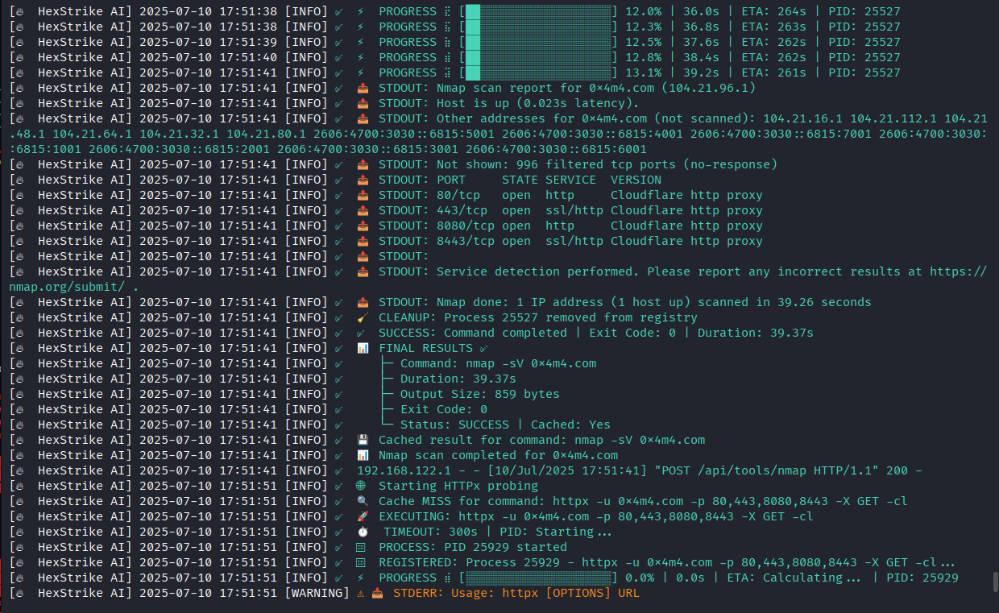
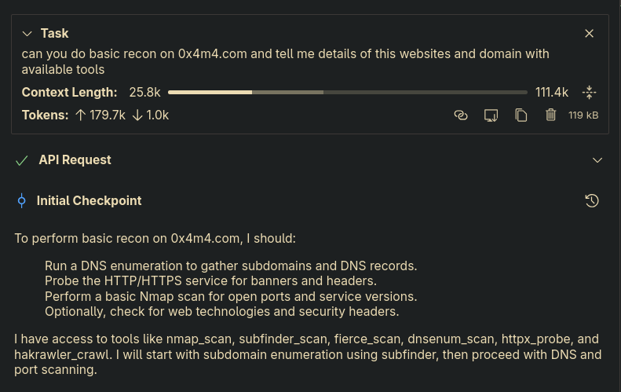
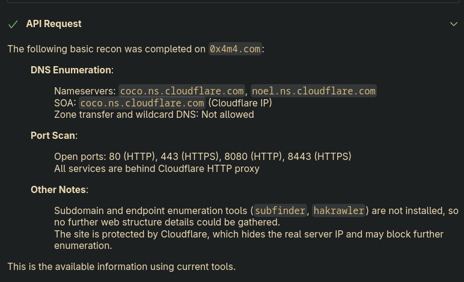

# Aegis-360-ai

```
 █████╗ ███████╗ ██████╗ ██╗███████╗    ██████╗  ██████╗  ██████╗
██╔══██╗██╔════╝██╔════╝ ██║██╔════╝    ╚════██╗██╔════╝ ██╔═████╗
███████║█████╗  ██║  ███╗██║███████╗     █████╔╝███████╗ ██║██╔██║
██╔══██║██╔══╝  ██║   ██║██║╚════██║     ╚═══██╗██╔═══██╗████╔╝██║
██║  ██║███████╗╚██████╔╝██║███████║    ██████╔╝╚██████╔╝╚██████╔╝
╚═╝  ╚═╝╚══════╝ ╚═════╝ ╚═╝╚══════╝    ╚═════╝  ╚═════╝  ╚═════╝
                                                        AI  v1.1.0
```

[](https://python.org)
[](LICENSE)
[](https://kali.org)
[]()
[](https://github.com/Mafia721/aegis-360-ai/stargazers)

**Aegis-360 AI** is an AI-augmented penetration testing framework for professional red teamers,
bug bounty hunters, and CTF players. It exposes 200+ security tools to Claude Desktop via the
MCP protocol, with an autonomous ReAct agent loop and smart multi-model AI routing.

> **Authorized use only.** This framework is for legal penetration testing engagements,
> bug bounty programs, CTF competitions, and security research.

---

## Features

- **200+ integrated security tools** — nmap, nuclei, ffuf, sqlmap, gobuster, subfinder, katana, dalfox, hydra, hashcat, and many more
- **MCP bridge** — exposes all tools natively inside Claude Desktop via `aegis_360_mcp.py`
- **Multi-model orchestration engine** — `aegis_360_orchestrator.py` enforces a strict phased workflow: DeepSeek V4 Pro handles recon/enumeration/vuln analysis; Claude API is gated exclusively to exploitation and reporting phases
- **Autonomous ReAct agent** — multi-step exploit chains with tool selection, execution, and reasoning
- **Smart AI routing** — Claude Sonnet for exploitation, Groq (free) for recon/planning/OSINT/code, DeepSeek V4 Pro for deep analysis phases
- **Flask REST API** — 300+ endpoints at `http://127.0.0.1:8888`, fully scriptable
- **Burp Suite integration** — proxy chaining, REST API, history export via `tools/burp_history_exporter.py` and `tools/fetch_burp_history.py`
- **Bundled third-party tools** — arjun, dotdotpwn, mcphammer, paramspider, xsstrike (under `tools/`)
- **LLM adversarial testing** — 210+ attack probes via Augustus integration
- **Binary exploitation** — pwntools, angr, AFL++, rr-debugger, CodeQL
- **Active Directory** — Impacket, Bloodhound, NetExec, evil-winrm
- **Cloud & containers** — Prowler, Trivy, kube-hunter, ScoutSuite, Checkov
- **OSINT** — Shodan, Censys, TheHarvester, Recon-ng, Sherlock
- **Fallback CLI** — `aegis360chat.py` for terminal-only sessions without Claude Desktop

---

## Architecture

```
Claude Desktop / Claude Code (Orchestrator)
    │
    ├── aegis_360_mcp.py       (spawned per session — MCP stdio protocol)
    │       │
    │       └── HTTP ──► aegis_360_server.py (127.0.0.1:8888)
    │                           │
    │                           ├── System tools (nmap, nuclei, ffuf, sqlmap …)
    │                           ├── Go tools (subfinder, httpx, katana …)
    │                           ├── AI APIs (Anthropic, Groq, OpenRouter, DeepSeek)
    │                           └── Modules (augustus, praetorian)
    │
    ├── aegis_360_orchestrator.py  (multi-model phased workflow engine)
    │       │
    │       ├── DeepSeek V4 Pro  → RECON / ENUMERATION / VULN ANALYSIS
    │       └── Claude API       → EXPLOITATION / REPORTING (post-gate only)
    │
    └── aegis360chat.py        (optional standalone CLI — no Claude Desktop needed)
```

| Component | Role | Size |
|-----------|------|------|
| `aegis_360_server.py` | Flask API server — 300+ endpoints, all tool execution | ~19 600 lines |
| `aegis_360_mcp.py` | MCP client — 200+ tools exposed to Claude Desktop | ~13 100 lines |
| `aegis_360_orchestrator.py` | Multi-model phased workflow engine with validation gate | ~600+ lines |
| `aegis360chat.py` | Standalone CLI with auto-routing between AI models | ~690 lines |
| `modules/augustus.py` | LLM adversarial testing (210+ attack probes) | ~413 lines |
| `modules/praetorian.py` | Praetorian commercial toolset integration | ~792 lines |
| `tools/` | Bundled third-party tools (arjun, dotdotpwn, mcphammer, paramspider, xsstrike) | — |

---

## Requirements

- **OS:** Kali Linux 2024.1+ (recommended), Ubuntu 22.04+, macOS 13+
- **Python:** 3.11 or 3.12 (3.13 supported)
- **API keys (minimum):** `ANTHROPIC_API_KEY` + `GROQ_API_KEY`
- **Optional:** `OPENROUTER_API_KEY`, Shodan, Censys, HIBP, VirusTotal keys

### Python dependencies

```
flask, requests, psutil, fastmcp, anthropic, python-dotenv, openai,
beautifulsoup4, selenium, webdriver-manager, aiohttp, mitmproxy,
pwntools, angr
```

### External security tools (install separately)

Kali Linux ships with most tools. For the full 150+ tool list see
[TOOLS.md](TOOLS.md) and [CAPABILITIES.md](CAPABILITIES.md).

---

## Installation

### Quick install (Linux / macOS)

```bash
git clone https://github.com/Mafia721/aegis-360-ai.git
cd aegis-360-ai
chmod +x install.sh
./install.sh
```

The script will:
1. Detect your Python version (3.11+)
2. Install system packages via `apt` or `brew`
3. Create a virtual environment at `aegis-360-env/`
4. Install all Python dependencies
5. Copy `.env.example` → `.env` and prompt you to fill in API keys
6. Generate `aegis-360-ai-mcp.json` with your install path

### Manual install

```bash
python3 -m venv aegis-360-env
source aegis-360-env/bin/activate
pip install -r requirements.txt
cp .env.example .env
nano .env          # add your API keys
```

### Additional security tools

```bash
sudo chmod +x install_sudo_tools.sh
sudo ./install_sudo_tools.sh
```

---

## Configuration

Copy and edit the environment template:

```bash
cp .env.example .env
```

Minimum required keys:

```env
ANTHROPIC_API_KEY=sk-ant-...    # Claude API (exploitation tasks)
GROQ_API_KEY=gsk_...            # Groq free tier (recon/planning/code)
```

Full configuration reference: [.env.example](.env.example)

---

## Usage

### 1 — Start the backend server

```bash
source aegis-360-env/bin/activate
python3 aegis_360_server.py
```

Server starts at `http://127.0.0.1:8888`. Verify with:

```bash
curl http://127.0.0.1:8888/health
```

### 2 — Connect Claude Desktop (primary interface)

Add to your Claude Desktop MCP config (`claude_desktop_config.json`):

```json
{
  "mcpServers": {
    "aegis-360-ai": {
      "type": "stdio",
      "command": "/path/to/aegis-360-ai/aegis-360-env/bin/python3",
      "args": ["/path/to/aegis-360-ai/aegis_360_mcp.py", "--server", "http://127.0.0.1:8888"],
      "timeout": 300,
      "alwaysAllow": []
    }
  }
}
```

Or use the generated config file:

```bash
# install.sh generates this automatically:
cat aegis-360-ai-mcp.json
```

### 3 — Fallback CLI (no Claude Desktop required)

```bash
source aegis-360-env/bin/activate
python3 aegis360chat.py                    # interactive REPL with auto-routing
python3 aegis360chat.py --model llama33    # lock to a free Groq model
python3 aegis360chat.py --model all        # broadcast to all free models
python3 aegis360chat.py --ask "question"   # one-shot query
python3 aegis360chat.py --agent "task"     # autonomous agent run
python3 aegis360chat.py --recon example.com
python3 aegis360chat.py --vuln https://target.com
```

### CLI flags

```
usage: aegis360chat.py [-h] [--model MODEL] [--list] [--ask QUESTION]
                        [--agent TASK] [--recon TARGET] [--vuln TARGET]
                        [--max-iter N]

options:
  --model MODEL     auto (default) | llama33 | llama4 | qwen3 | gptoss | fast | claude | all
  --list            list available models and their status
  --ask QUESTION    one-shot question (non-interactive)
  --agent TASK      run autonomous ReAct agent on TASK
  --recon TARGET    recon agent: subfinder+nmap+httpx+katana+nuclei
  --vuln  TARGET    vuln agent: nuclei+nikto+gobuster+dalfox+ffuf+sqlmap
  --max-iter N      agent max iterations (default 10)
```

---

## AI Model Routing

| Task type | Model | Provider | Cost |
|-----------|-------|----------|------|
| Orchestration / planning | Claude Code | Anthropic | Paid |
| Recon / enumeration / vuln analysis | DeepSeek V4 Pro | DeepSeek | Paid |
| Exploitation / payload (post-gate) | Claude Sonnet 4.6 | Anthropic | Paid |
| Final report generation | Claude Sonnet 4.6 | Anthropic | Paid |
| Planning / strategy (chat) | Llama 3.3 70B | Groq | Free |
| OSINT / info gather | OpenAI OSS 120B | Groq | Free |
| Code / PoC writing | Qwen3 32B | Groq | Free |
| Log / output parsing | Qwen3 32B | Groq | Free |
| Deep analysis | OpenAI OSS 120B | Groq | Free |
| Quick lookups | Llama 3.1 8B | Groq | Free |

> **Orchestrator note:** `aegis_360_orchestrator.py` enforces model separation via a validation gate — Claude API cannot be invoked in RECON, ENUMERATION, VULNERABILITY_ANALYSIS, or VALIDATION_GATE phases. Attempting to do so raises a `PhaseViolationError`. All handoffs are timestamped and logged.

---

## Tool Categories

See [CAPABILITIES.md](CAPABILITIES.md) for the full 200+ tool breakdown.

| Category | Count | Example tools |
|----------|-------|---------------|
| Network recon | 25+ | nmap, masscan, rustscan, subfinder, amass |
| Web app security | 40+ | nuclei, gobuster, ffuf, sqlmap, dalfox, nikto |
| Authentication | 12+ | hydra, hashcat, john, medusa, netexec |
| Binary / RE | 25+ | ghidra, radare2, angr, pwntools, AFL++, rr |
| Cloud / containers | 20+ | prowler, trivy, kube-hunter, checkov |
| Active Directory | 15+ | impacket, bloodhound, netexec, evil-winrm |
| OSINT / Intel | 20+ | theHarvester, sherlock, shodan-cli, recon-ng |
| CTF / forensics | 20+ | volatility3, autopsy, steghide, binwalk |
| LLM security | 210+ | augustus (adversarial probes, 28 providers) |
| Burp Suite | Full | proxy chain, REST API, history export |

---

## Screenshots

<p align="center">
  
</p>

| Server output | MCP task view | MCP recon output |
|---------------|---------------|-----------------|
|  |  |  |

---

## Roadmap

- [ ] Web UI dashboard for live tool output
- [ ] Campaign manager (multi-target tracking)
- [ ] Auto-generated pentest reports (PDF/DOCX)
- [ ] Nuclei template auto-updater
- [ ] Integration with Metasploit RPC
- [ ] Docker container for portable deployment

---

## Disclaimer

This framework is provided for **authorized security testing only**. You are solely
responsible for ensuring you have written permission for every target. Unauthorized
access to computer systems is illegal. The author and contributors accept no liability
for misuse.

---

## License

MIT License — see [LICENSE](LICENSE).

---

## Author

**[BinaryGalaxys](https://github.com/BinaryGalaxys)** — penetration testing & security tooling.
